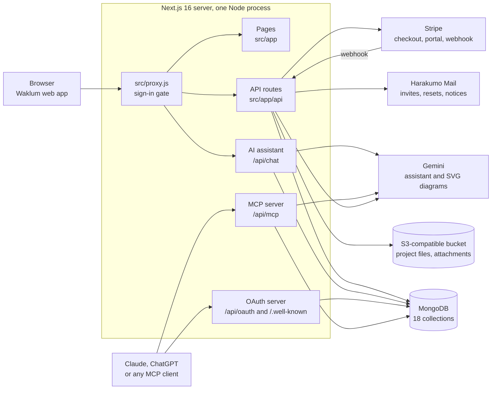
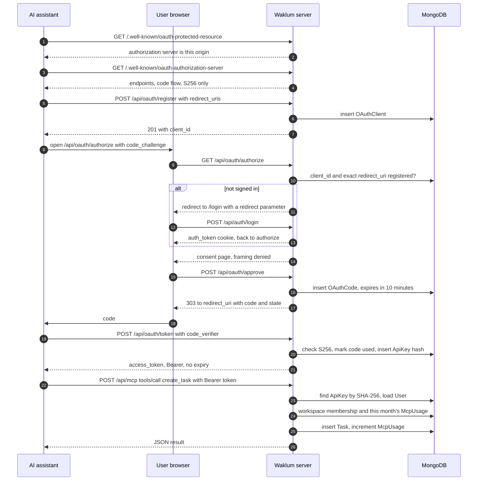
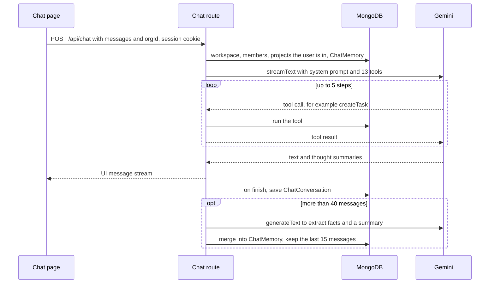

# Architecture

Waklum is AI-native project management: workspaces, projects, Kanban boards, docs and
files, an in-app AI project manager, and an MCP connector so Claude, ChatGPT or any MCP
client can work on your projects from a conversation.

It is **one Next.js 16 server** (App Router, JavaScript) that serves both the web app and
its API. Everything it stores lives in **one MongoDB database** (Mongoose models in
`src/models/`). Files go to **any S3-compatible bucket**. Four outside services are
optional: **Gemini** (AI), **Harakumo Mail** (email), **Stripe** (billing) and the bucket.
There are no background jobs, queues or websockets.

## The parts



| Part | Where | What it does |
| --- | --- | --- |
| Pages | `src/app/**/page.js` (26 pages) | The landing page, sign-in pages and the signed-in app. Client components that call the API with `fetch`. |
| Proxy | `src/proxy.js` | Next 16's name for middleware. Verifies the session cookie, sends signed-out visitors to `/login` and answers 401 for protected API routes. It skips `/api/mcp`, `/api/oauth` and `/.well-known`, which authenticate themselves. Every protected route also checks the session itself. |
| API routes | `src/app/api/**/route.js` (47 files) | JSON route handlers for auth, workspaces, projects, tasks, docs, files, notifications, search, billing and admin. |
| AI assistant | `src/app/api/chat/route.js` | Streams a Gemini conversation with 13 tools that read and change the current workspace. Keeps one conversation and one long-term memory per user per workspace. |
| OAuth server | `src/app/api/oauth/*`, `src/app/.well-known/*` | Discovery metadata, dynamic client registration, an approval page and a token endpoint (authorization code with PKCE S256). The access token it issues is an API key. |
| MCP server | `src/app/api/mcp/route.js` | Stateless Streamable HTTP MCP server with 11 tools for workspaces, projects, tasks and docs. Authenticates with an API key as a Bearer token and meters calls per workspace per month. |
| Database | MongoDB via Mongoose, `src/lib/db.js`, `src/models/` | One cached connection per process (pool of 10). Indexes are declared on the models. See `SYSTEM-DESIGN.md` for every collection. |
| Storage | `src/lib/storage.js` | An S3 client pointed at `STORAGE_ENDPOINT`. Objects are keyed `projects/<projectId>/<timestamp>-<name>` and served from `STORAGE_PUBLIC_URL`. |
| Email | `src/lib/email.js`, `src/lib/harakumo.js` | HTML templates sent with one POST to Harakumo Mail (`/api/mail/send`, 15 s timeout). |
| Billing | `src/lib/stripe.js`, `src/app/api/billing/*` | Stripe Checkout for the Pro and Team plans, the customer portal, and a signed webhook that writes the plan onto the user. |
| Admin | `src/app/admin/page.js`, `src/app/api/admin/*` | Users, workspaces, subscriptions, contact messages and totals, for the addresses in `ADMIN_EMAILS`. |

## Pages

| Path | Page |
| --- | --- |
| `/` | Landing page with the connector URL and a contact form |
| `/login`, `/signup`, `/forgot-password`, `/reset-password/[token]` | Email or username and password sign-in, sign-up, password reset |
| `/invite/[token]` | Shows a workspace invite and accepts it (or sends the person to sign up) |
| `/dashboard` | Overview of the active workspace |
| `/dashboard/projects`, `/dashboard/projects/new` | Project list and creation |
| `/dashboard/projects/[id]` | Kanban board (drag and drop with `@dnd-kit`) |
| `/dashboard/projects/[id]/list`, `/timeline`, `/summary` | List view, due-date timeline, project summary |
| `/dashboard/projects/[id]/docs` | Project docs with AI-generated SVG diagrams |
| `/dashboard/projects/[id]/files` | Project files and folders |
| `/dashboard/projects/[id]/members`, `/settings` | Project members and settings |
| `/dashboard/tasks` | Tasks assigned to me in the active workspace |
| `/dashboard/team` | Workspace members, roles and invites |
| `/dashboard/chat` | The AI project manager |
| `/dashboard/notifications`, `/dashboard/analytics` | Notifications and workspace analytics (charts with Recharts) |
| `/dashboard/billing` | Plans, upgrade and the Stripe portal (`/dashboard/settings/billing` redirects here) |
| `/dashboard/settings` | Profile, security and teams tabs. The profile and password forms are not wired to an API yet. |
| `/admin` | Admin dashboard |

The active workspace is kept in the browser (`localStorage` key `activeOrganizationId`,
`src/context/OrganizationContext.js`), and the signed-in user comes from `/api/auth/me`
(`src/context/AuthContext.js`).

## API routes

Auth column: **public** means no session; **session** means a valid `auth_token` cookie;
**Bearer** means an API key in the `Authorization` header. Finer checks are listed in
`SYSTEM-DESIGN.md` under roles and permissions.

| Area | Routes | Auth |
| --- | --- | --- |
| Sign-in | `POST /api/auth/signup`, `login`, `logout`, `forgot-password`, `reset-password`; `GET /api/auth/me` | public (rate limited), `me` and `logout` use the session |
| Invites | `GET/POST /api/invites/accept`; `POST/DELETE /api/organizations/[id]/invites`; `POST /api/organizations/[id]/invites/respond` | accept is public, the rest session |
| Workspaces | `GET/POST /api/organizations`; `DELETE/PATCH /api/organizations/[id]/members`; `GET /api/organizations/[id]/analytics` | session |
| Projects | `GET/POST /api/projects`; `GET/PUT/DELETE /api/projects/[id]`; `POST/DELETE /api/projects/[id]/members`; `POST/DELETE /api/projects/[id]/files` | session |
| Tasks | `GET/POST /api/projects/[id]/tasks`; `GET /api/tasks`; `GET/PUT/DELETE /api/tasks/[id]`; `GET/POST /api/tasks/[id]/comments`; `POST/DELETE /api/tasks/[id]/attachments`; `GET /api/tasks/[id]/activity`; `GET /api/activities` | session |
| Docs | `GET/POST /api/projects/[id]/docs`; `GET/PUT/DELETE /api/projects/[id]/docs/[docId]`; `POST /api/ai/generate-visual` | session |
| Uploads | `POST /api/upload/direct` (multipart through the server, used by the UI); `POST /api/upload` (presigned PUT URL for API clients) | session and project membership |
| AI assistant | `POST /api/chat`; `GET/DELETE /api/chat/history` | session |
| Connector | `GET /.well-known/oauth-protected-resource`, `GET /.well-known/oauth-authorization-server`, `POST /api/oauth/register`, `GET /api/oauth/authorize`, `POST /api/oauth/approve`, `POST /api/oauth/token`; `GET/POST/DELETE/OPTIONS /api/mcp` | public, approve needs a session, MCP needs Bearer |
| API keys | `GET/POST/DELETE /api/keys` | session (no screen in the app calls it yet) |
| Other | `GET/PUT /api/notifications`; `GET /api/search`; `POST /api/contact` | session (see the note on the contact form below) |
| Billing | `POST /api/billing/checkout`, `POST /api/billing/portal`; `POST /api/billing/webhook` | session; the webhook is public and checks the Stripe signature |
| Admin | `GET /api/admin/stats`, `users`, `organizations`, `subscriptions`; `GET/PATCH /api/admin/contacts` | session and an email in `ADMIN_EMAILS` |

`POST /api/contact` says "public" in its code, but the proxy does not list it among the
public API routes, so a signed-out visitor's form submission gets a 401.

## Database

Eighteen Mongoose models, one collection each: `User`, `Organization`, `Project`, `Task`,
`Comment`, `Doc`, `Activity`, `Notification`, `Milestone`, `ApiKey`, `OAuthClient`,
`OAuthCode`, `McpUsage`, `ChatConversation`, `ChatMemory`, `PasswordReset`, `RateLimit`,
`Contact`. Workspace members and invites, project members, board columns and project files
are arrays embedded in their parent document rather than collections of their own. Fields,
types and indexes are in `SYSTEM-DESIGN.md`.

## Storage

Project files and task attachments are uploaded to the bucket and their metadata saved in
MongoDB (`Project.files`, `Task.attachments`). Two upload paths exist:

- `POST /api/upload/direct`: the browser sends multipart form data, the server checks size
  (25 MB) and project membership, then writes the object with `PutObject`. The UI uses this.
- `POST /api/upload`: returns a presigned PUT URL valid for 5 minutes with the declared
  `ContentLength` signed in, for API clients.

Objects are read from `STORAGE_PUBLIC_URL`, so the bucket (or the domain in front of it)
must serve them publicly. Deleting a file or a project removes the metadata only; nothing
calls the bucket to delete objects.

## Sign-in

- **Web app**: email or username and password (bcrypt). A successful sign-in sets an
  `auth_token` cookie holding an HS256 JWT (`jose`) with `userId` and `email`, valid 7 days,
  `httpOnly`, `SameSite=Lax`, `Secure` in production. There is no server-side session store.
  Google sign-in was retired; accounts created with it set a password through the reset flow.
- **MCP clients**: an API key (`pw_sk_` + 64 hex characters) sent as a Bearer token. Keys are
  stored as SHA-256 hashes. A key comes from the OAuth flow or from `POST /api/keys`.
- **Admin**: a signed-in user whose email is in `ADMIN_EMAILS`.

## Payments

Billing is per user. `POST /api/billing/checkout` takes a plan name (`pro` or `team`),
looks up the Price id from `STRIPE_PRICE_PRO` / `STRIPE_PRICE_TEAM` and creates a Checkout
Session tagged with the user id. The webhook (`checkout.session.completed`,
`customer.subscription.updated`, `customer.subscription.deleted`) writes the plan, customer,
subscription and period end onto `User.subscription`. A workspace's plan is its owner's plan.
Without `STRIPE_SECRET_KEY` everyone stays on Free and upgrades answer 503.

## Outside services and what happens without them

| Service | Configured by | Used for | Without it |
| --- | --- | --- | --- |
| MongoDB | `MONGODB_URI` | Everything | The app does not work |
| Gemini | `GOOGLE_GENERATIVE_AI_API_KEY` | AI assistant (`gemini-flash-latest` through the AI SDK), SVG diagrams in docs | The assistant and diagram generation fail; connector docs are saved without their diagrams |
| S3-compatible bucket | `STORAGE_BUCKET`, `STORAGE_ACCESS_KEY_ID`, `STORAGE_SECRET_ACCESS_KEY`, `STORAGE_ENDPOINT`, `STORAGE_PUBLIC_URL`, optional `STORAGE_REGION` | Project files, task attachments | Uploads answer 503 |
| Harakumo Mail | `HARAKUMO_API_KEY`, optional `HARAKUMO_BASE_URL`, `MAIL_FROM_NAME`, `MAIL_FROM` | Invite, project-invite, project-added, task-assignment and password-reset emails | Nothing is emailed and each failure is logged; invites are still saved |
| Stripe | `STRIPE_SECRET_KEY`, `STRIPE_WEBHOOK_SECRET`, `STRIPE_PRICE_PRO`, `STRIPE_PRICE_TEAM` | Paid plans | Everyone is on Free |

`NEXT_PUBLIC_APP_URL` is the public origin used in email links, OAuth metadata, Stripe
return URLs and the connector URL on the landing page. It is inlined at build time.

## Main request: an AI assistant connects and creates a task

The connector is the part that sets Waklum apart, so this is its full path, from discovery
to a tool call.



## The in-app assistant



## Realtime and background work

- **No realtime transport.** The top bar polls `/api/notifications` every 5 minutes and when
  the tab becomes visible again. Boards and lists refetch after the user's own changes; other
  people's changes appear on reload.
- **No background jobs.** Work that looks asynchronous runs inside the request: emails are
  sent inline or fire-and-forget, activity rows are written without awaiting, and chat
  history is saved and compressed in the stream's `onFinish` callback.
- **Expiry is done by MongoDB TTL indexes**: OAuth codes at `expiresAt`, password-reset
  tokens a day after expiry, rate-limit windows a minute after they lapse.

## Deployment

- `npm run build && npm start`, or the `Dockerfile`: a three-stage `node:22-alpine` build with
  Next's standalone output, running as a non-root user on port 8080. `NEXT_PUBLIC_APP_URL` is
  a build argument; no other secret is needed at build time.
- `npm run db:indexes` (`scripts/ensure-indexes.mjs`) builds every declared index before a
  deploy; otherwise Mongoose builds them on first use.
- `next.config.ts` raises the proxy's request-body buffer to 26 MB so a 25 MB upload fits.

## Code map

```
src/
  app/                 pages and API routes (App Router)
    api/mcp/           the MCP server
    api/oauth/         OAuth: register, authorize, approve, token
    .well-known/       OAuth discovery metadata
    api/chat/          the in-app AI assistant
    dashboard/         the signed-in app
    admin/             admin dashboard
  components/          UI (layout, projects, organizations, ui primitives)
  context/             AuthContext, OrganizationContext
  hooks/               usePermissions (UI gating only)
  lib/                 auth, db, permissions, rbac, email, storage, stripe, rate limits
  models/              Mongoose models
  proxy.js             sign-in gate
scripts/
  ensure-indexes.mjs   npm run db:indexes
```
