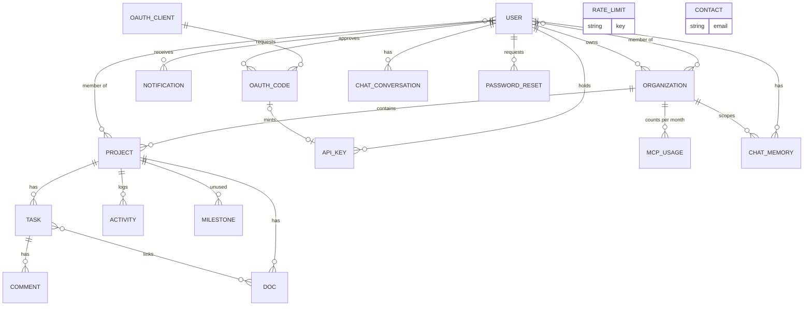

# System design

How Waklum stores data, what happens in each main flow, who may do what, the limits, how
failures are handled, security, and how it scales. Everything here describes the code in
this repository; where something is not built, this document says so.

## Data model

MongoDB through Mongoose. One model per file in `src/models/`, one collection per model.
Every model except `RateLimit` has Mongoose `createdAt` / `updatedAt` timestamps. `ObjectId → X`
means a reference to collection X.

### User (`src/models/User.js`)

| Field | Type | Notes |
| --- | --- | --- |
| `name` | String | required |
| `email` | String | required, unique |
| `username` | String | required, unique |
| `passwordHash` | String | bcrypt; empty for accounts made with the retired Google sign-in |
| `avatar` | String | URL |
| `authProvider` | String | `local` or `google`, default `local` |
| `googleId` | String | legacy |
| `subscription.plan` | String | `free`, `pro`, `team`, `enterprise`; default `free`. The plan that counts for billing |
| `subscription.stripeCustomerId` | String | |
| `subscription.stripeSubscriptionId` | String | set while a subscription is live |
| `subscription.currentPeriodEnd` | Date | |
| `organizations` | [ObjectId → Organization] | workspaces the user belongs to |
| `preferences.theme` | String | default `dark`; not read by the app |
| `preferences.notifications.email`, `.inApp` | Boolean | default true; not read by the app |
| `lastLoginAt` | Date | set on sign-in |

### Organization (`src/models/Organization.js`), a workspace

| Field | Type | Notes |
| --- | --- | --- |
| `name` | String | required |
| `slug` | String | required, unique |
| `plan` | String | `free`, `pro`, `team`, `enterprise`. Legacy: billing reads the owner's `User.subscription.plan` |
| `owner` | ObjectId → User | required |
| `members[]` | embedded | `user` (ObjectId → User), `role` (`owner`, `admin`, `manager`, `member`, `guest`; default `member`), `invitedBy` (ObjectId → User), `joinedAt` (Date), `status` (`active`, `invited`, `suspended`; default `active`) |
| `pendingInvites[]` | embedded | `email` (String), `role` (String), `invitedBy` (ObjectId → User), `token` (String, 32 random bytes hex), `expiresAt` (Date, 7 days), `projectIds` ([ObjectId → Project]), `projectRole` (String, default `member`), `invitedAt` (Date), `createdAt` (Date) |
| `stripeCustomerId`, `stripeSubscriptionId` | String | legacy; the portal route falls back to `stripeCustomerId` for older subscribers |
| `limits.maxProjects`, `.maxMembers`, `.maxStorage`, `.aiCallsPerMonth` | Number | defaults 2, 3, 1 GB, 50. Stored, never checked |
| `settings.defaultProjectRole` | String | default `member`; not read |
| `settings.allowMemberInvites`, `.requireApproval` | Boolean | default false; not read |

Indexes: unique `slug`.

### Project (`src/models/Project.js`)

| Field | Type | Notes |
| --- | --- | --- |
| `name` | String | required |
| `description` | String | |
| `slug` | String | required, not unique |
| `organization` | ObjectId → Organization | required |
| `status` | String | `active`, `on-hold`, `completed`, `archived`; default `active` |
| `visibility` | String | `private`, `team`, `public`; default `team`. Stored, not used for access |
| `members[]` | embedded | `user` (ObjectId → User), `role` (`owner`, `admin`, `member`, `viewer`; default `member`), `addedBy` (ObjectId → User), `joinedAt` (Date) |
| `tags` | [String] | |
| `color`, `icon` | String | |
| `columns[]` | embedded | `id`, `name`, `color` (String), `order` (Number). New projects get backlog, todo, in-progress, review, done |
| `files[]` | embedded | `name`, `url`, `key` (String), `size` (Number), `type` (String), `isFolder` (Boolean), `folder` (String, default `/`), `uploadedBy` (ObjectId → User), `uploadedAt` (Date) |
| `createdBy` | ObjectId → User | required |

Indexes: `{ organization: 1, createdAt: -1 }`, `{ 'members.user': 1 }`.

### Task (`src/models/Task.js`)

| Field | Type | Notes |
| --- | --- | --- |
| `title` | String | required |
| `description` | String | |
| `project` | ObjectId → Project | required |
| `status` | String | `backlog`, `todo`, `in-progress`, `review`, `done`; default `todo` |
| `columnId` | String | board column; kept equal to `status` by `PUT /api/tasks/[id]` |
| `order` | Number | position on the board |
| `priority` | String | `urgent`, `high`, `medium`, `low`; default `medium` |
| `assignee` | ObjectId → User | primary assignee |
| `assignees` | [ObjectId → User] | additional assignees |
| `reporter` | ObjectId → User | required |
| `labels` | [String] | |
| `dueDate`, `startDate` | Date | |
| `estimatedHours`, `loggedHours` | Number | |
| `subtasks[]` | embedded | `title` (String), `completed` (Boolean) |
| `attachments[]` | embedded | `name`, `url` (String), `size` (Number), `fileType` (String), `uploadedBy` (ObjectId → User), `uploadedAt` (Date) |
| `linkedDocs` | [ObjectId → Doc] | docs from the same project |
| `milestone` | ObjectId → Milestone | not used |
| `dependencies` | [ObjectId → Task] | not used |
| `createdBy` | ObjectId → User | required |

Indexes: `{ project: 1, order: 1, createdAt: -1 }`, `{ project: 1, status: 1 }`,
`{ assignee: 1, dueDate: 1 }`, `{ assignees: 1 }`.

### Comment (`src/models/Comment.js`)

`task` (ObjectId → Task, required), `author` (ObjectId → User, required), `content` (String,
required), `attachments[]` (`name`, `url` String), `reactions[]` (`emoji` String, `users`
[ObjectId → User]), `editedAt` (Date). Attachments, reactions and edits are not used by any
route. Index: `{ task: 1, createdAt: 1 }`.

### Doc (`src/models/Doc.js`)

`title` (String, required), `content` (String, Markdown with optional
`<!-- SVG_VISUAL -->` blocks), `project` (ObjectId → Project, required), `createdBy`
(ObjectId → User, required), `lastEditedBy` (ObjectId → User), `order` (Number, default 0).
Index: `{ project: 1, order: 1 }`.

### Activity (`src/models/Activity.js`)

`project` (ObjectId → Project, required), `actor` (ObjectId → User, required), `action`
(String, required: `status_changed`, `priority_changed`, `assignee_changed`,
`assignees_added`), `targetType` (String, required; only `task` is written), `targetId`
(ObjectId, required), `metadata` (Mixed). Written only by `PUT /api/tasks/[id]`.
Index: `{ project: 1, createdAt: -1 }`.

### Notification (`src/models/Notification.js`)

`recipient` (ObjectId → User, required, indexed), `type` (String, required, one of
`task_assigned`, `task_updated`, `task_due_soon`, `comment_added`, `comment_mentioned`,
`invite_received`, `workspace_invite`, `invite_accepted`, `member_joined`, `member_removed`,
`project_created`, `project_added`), `title`, `message` (String, required), `read` (Boolean,
default false), `link` (String), `actor` (ObjectId → User), `metadata` (`projectId`,
`taskId`, `orgId` ObjectIds; `projectName`, `taskTitle`, `orgName`, `inviteRole`,
`inviteToken` Strings). Index: `{ recipient: 1, read: 1, createdAt: -1 }`.

### Milestone (`src/models/Milestone.js`)

`project` (ObjectId → Project, required), `name` (String, required), `description`
(String), `dueDate` (Date), `status` (`open`, `in-progress`, `completed`), `progress`
(Number). No route or page uses it.

### ApiKey (`src/models/ApiKey.js`)

`key` (String, required, unique: the SHA-256 hex of the raw key), `prefix` (String,
required: first 12 characters, shown in lists), `name` (String, default `API Key`; OAuth
keys are named `Claude Connector (auto)`), `user` (ObjectId → User, required), `lastUsedAt`
(Date, updated on each use), `expiresAt` (Date, never set or checked).

### OAuthClient (`src/models/OAuthClient.js`)

`clientId` (String, required, unique: `pw_client_` + 32 hex), `clientName` (String, default
`MCP Client`, at most 80 characters), `redirectUris` ([String]), `grantTypes` ([String]),
`tokenEndpointAuthMethod` (String, default `none`).

### OAuthCode (`src/models/OAuthCode.js`)

`code` (String, required, unique: 32 random bytes hex), `userId` (ObjectId → User,
required), `clientId` (String, required), `redirectUri` (String, required), `codeChallenge`,
`codeChallengeMethod` (String), `expiresAt` (Date, required, 10 minutes), `used` (Boolean),
`apiKeyId` (ObjectId → ApiKey, the token minted from it), `replayed` (Boolean).
Index: TTL on `expiresAt`, so codes are deleted when they expire.

### McpUsage (`src/models/McpUsage.js`)

`organization` (ObjectId → Organization, required), `month` (String `YYYY-MM`, UTC, required),
`callCount` (Number), `lastCallAt` (Date). Unique index `{ organization: 1, month: 1 }`.

### ChatConversation (`src/models/ChatConversation.js`)

`userId` (ObjectId → User, required, indexed), `orgId` (ObjectId → Organization),
`messages[]` (`role`: `user`, `assistant`, `system`, `tool`; `content` String; `parts`
Mixed, the AI SDK message parts), `title` (String), `updatedAt` (Date). One document per
user per workspace. Index: `{ userId: 1, updatedAt: -1 }`.

### ChatMemory (`src/models/ChatMemory.js`)

`userId` (ObjectId → User, required), `orgId` (ObjectId → Organization, required),
`memories[]` (`fact` String required; `category`: `preference`, `decision`, `context`,
`task_pattern`; `importance`: `high`, `medium`, `low`; `createdAt` Date), `summary`
(String), `lastCompressedAt` (Date), `compressionCount` (Number). Unique index
`{ userId: 1, orgId: 1 }`.

### PasswordReset (`src/models/PasswordReset.js`)

`user` (ObjectId → User, required), `token` (String, required, unique: 32 random bytes hex),
`expiresAt` (Date, required, 1 hour), `used` (Boolean). TTL index deletes rows a day after
`expiresAt`.

### RateLimit (`src/models/RateLimit.js`)

`key` (String, required, unique: `<bucket>:<client ip>`), `count` (Number), `expiresAt`
(Date, end of the window). No timestamps. TTL index deletes rows a minute after the window.

### Contact (`src/models/Contact.js`)

`name`, `email`, `message` (String, required), `status` (`new`, `read`, `replied`; default
`new`).

## Main flows

### Sign up

1. `POST /api/auth/signup` (5 per hour per IP) with name, email, username, password and an
   optional `inviteToken`.
2. Refuses a taken email or username (409). Hashes the password with bcrypt (10 rounds).
3. With a valid invite token whose email matches, adds the user to that workspace with the
   invited role and removes the invite. Otherwise creates a personal workspace
   ("<name>'s Workspace") with the user as owner.
4. Signs a session JWT, sets the `auth_token` cookie, returns 201.

The 8-character password minimum is checked by the sign-up page, not by this route.

### Sign in and sessions

1. `POST /api/auth/login` (10 per 15 minutes per IP) with an email or username and password.
2. Unknown user and wrong password both answer "Invalid credentials". An account without a
   password (retired Google sign-in) is told to use "Forgot password?".
3. On success: `lastLoginAt` is set, a 7-day HS256 JWT `{ userId, email }` goes into the
   `auth_token` cookie.
4. On every later request `src/proxy.js` verifies the JWT; protected routes call
   `getSession()` again. `POST /api/auth/logout` deletes the cookie.

### Password reset

1. `POST /api/auth/forgot-password` (5 per hour per IP) with an email or username. Always
   answers success, whether or not the account exists.
2. Deletes the user's old reset tokens, stores a new random token valid 1 hour, emails
   `/reset-password/<token>`.
3. `POST /api/auth/reset-password` (10 per hour per IP) checks the token is unused and not
   expired, requires 8 or more characters, stores a bcrypt hash (12 rounds), marks the token used.

### Invite someone to a workspace

1. `POST /api/organizations/[id]/invites` with email, role (`admin`, `manager`, `member`,
   `guest`) and optional project ids. Needs the `org:invite:members` permission (workspace
   owner, admin or manager).
2. If the person is already a member, they are added to the listed projects instead.
3. Otherwise a pending invite (random token, 7 days) is saved on the workspace. An existing
   user also gets a `workspace_invite` notification. An email with `/invite/<token>` is sent;
   if it fails the invite is still saved.
4. The person accepts in one of two ways:
   - **In the app** (notification): `POST /api/organizations/[id]/invites/respond` with
     `accept` or `decline`. The invite's email must match the signed-in account. Accepting
     adds them to the workspace and to each listed project as `member`, and notifies the inviter.
   - **From the email link**: `/invite/<token>` calls `POST /api/invites/accept`. A new
     address is sent to sign up with the token. An existing account is added to the workspace
     and signed in.
5. Owners and admins can cancel a pending invite (`DELETE /api/organizations/[id]/invites`).

### Add someone to a project

`POST /api/projects/[id]/members` by a project owner, admin or the creator. An existing user
is added to the workspace if needed, then to the project with the chosen role, and gets a
notification and an email. An unknown email gets a workspace invite carrying the project id
and a project invite email.

### Create and move a task

1. The board or the create modal calls `POST /api/projects/[id]/tasks`. The task goes to the
   end of its column (`order` = last + 1). A chosen assignee gets an in-app notification.
2. Dragging a card updates the board locally, then sends `PUT /api/tasks/[id]` with the new
   `columnId` and `order`.
3. The route loads the task and checks the caller: the creator or reporter, or a project
   owner or admin, may change anything; an assignee may change only `status`, `columnId`,
   `loggedHours`, `estimatedHours`, `assignees` and `subtasks`.
4. `status` and `columnId` are kept equal. Changes of status, priority, assignee and added
   assignees are written to `Activity`.
5. Notifications: a new primary assignee (in-app and email), new co-assignees, moved to review
   (the reporter), sent back from review (the assignee), done (reporter and assignee).

### Upload a file

1. The files page or the task modal posts the file to `POST /api/upload/direct` with the
   project id.
2. The route answers 503 without storage, 413 above 25 MB, 403 unless the caller is a member
   of the project. It writes the object under `projects/<projectId>/` and returns its public URL.
3. The page then saves the metadata: `POST /api/projects/[id]/files` (project file) or
   `POST /api/tasks/[id]/attachments` with `add-attachment` (task attachment).

API clients can instead ask `POST /api/upload` for a presigned PUT URL (5 minutes, size signed).

### Docs and AI diagrams

Docs are created and edited through `/api/projects/[id]/docs`. "Generate visual" calls
`POST /api/ai/generate-visual`, which asks Gemini for an SVG and returns it; the page inserts
it into the doc between `<!-- SVG_VISUAL -->` markers. Saved diagrams are rendered as an
`` with a data URI. The connector's `create_doc` and `update_doc` can generate up to 4
diagrams in parallel; any that fail are left out.

### The in-app AI assistant

1. `POST /api/chat` with the messages and the active workspace id.
2. Loads the workspace (the caller must be a member), its members, the projects the caller is
   in, and the caller's `ChatMemory` for that workspace, and builds a system prompt from them.
3. Streams `gemini-flash-latest` with up to 5 steps and 13 tools: `getProjects`,
   `createProject`, `getProjectDetails`, `getTeamMembers`, `getTasks`, `createTask`,
   `getTaskDetails`, `updateTask`, `updateTaskStatus`, `assignTask`, `addAssignees`,
   `getDocs`, `createDoc`. Thought summaries are streamed to the page.
4. When the stream finishes, the whole conversation is saved to `ChatConversation`.
5. Above 40 messages, Gemini extracts up to 10 facts and a summary from the older messages
   (first 8,000 characters). New facts are merged into `ChatMemory` (at most 50, most
   important kept, summary at most 2,000 characters) and the conversation is cut to a marker
   plus the last 15 messages.

### Connect an AI assistant (OAuth) and call a tool (MCP)

1. The client reads `/.well-known/oauth-protected-resource` and
   `/.well-known/oauth-authorization-server`, then registers at `POST /api/oauth/register`
   with its redirect URIs and gets a `client_id`.
2. It sends the user to `GET /api/oauth/authorize` with `response_type=code`, the redirect
   URI, state and an S256 `code_challenge`. The client and exact redirect URI must be
   registered. A signed-out user signs in first and comes back.
3. The consent page names the client (as it registered itself), shows where the approval
   goes and lists the access requested. "Authorize" posts to `/api/oauth/approve`, which
   re-checks the client and PKCE, stores a code valid 10 minutes and redirects with it.
4. `POST /api/oauth/token` with the code, `client_id`, redirect URI and `code_verifier`:
   checks expiry, client, redirect URI and the S256 hash (constant-time), marks the code used
   in one atomic update, mints an API key, records it on the code, and returns it as a
   Bearer access token without an expiry.
5. Each `POST /api/mcp` creates a fresh MCP server and transport (no session state), finds the
   API key by its hash and loads the user.
6. Tools that touch a workspace first check that the user belongs to it and that this month's
   `McpUsage` is under the plan limit, then increment it. The 11 tools are
   `list_organizations` (not counted), `create_organization`, `list_projects`,
   `create_project`, `get_project`, `list_tasks`, `create_task`, `update_task`, `list_docs`,
   `create_doc`, `update_doc`.

A second redemption of a code is refused and deletes the API key minted from it.

### Billing

1. `POST /api/billing/checkout` with `pro` or `team`: the route picks the Price id from the
   server's environment and creates a Stripe Checkout Session (subscription mode) with the
   user id in its metadata. The browser follows the returned URL.
2. Stripe calls `POST /api/billing/webhook`. The signature is verified; then
   `checkout.session.completed` sets the plan, customer, subscription and period end on the
   user; `customer.subscription.updated` updates plan and period end;
   `customer.subscription.deleted` sets the plan back to `free`.
3. `POST /api/billing/portal` opens the Stripe customer portal for the user's customer id.

### Admin

`/admin` calls `/api/admin/*`, which answer 403 unless the signed-in email is in
`ADMIN_EMAILS`. They list users, workspaces, billing customers and contact messages, and
compute totals and monthly recurring revenue from `PLAN_PRICES` in `src/lib/stripe.js`
(Pro $6, Team $12).

## Roles and permissions

Two levels, defined in `src/lib/permissions.js`:

| Workspace role | Permissions |
| --- | --- |
| owner | everything |
| admin | workspace settings, invite and remove members, create and delete projects |
| manager | invite members, create projects, create, edit, delete and assign tasks, comment |
| member | create projects, create, edit and assign tasks, comment |
| guest | comment |

| Project role | Permissions |
| --- | --- |
| owner | project settings, members, delete project, all task actions, comment and delete comments |
| admin | the same except deleting the project |
| member | create, edit and assign tasks, comment |
| viewer | read only |

The UI hides controls with `usePermissions` (`src/hooks/usePermissions.js`); that is
cosmetic. What the server checks, route by route:

| Action | Server check |
| --- | --- |
| Invite to a workspace | `requirePermission(ORG_INVITE_MEMBERS)`: workspace owner, admin, manager |
| Cancel an invite, remove a workspace member | workspace owner or admin; nobody can remove themselves or an owner. Removal also drops them from every project in the workspace |
| Change a workspace role | workspace owner only, not their own role, not another owner |
| Accept an invite in the app | the invite's email equals the account's email |
| Read a project | project member or creator |
| Edit project settings or columns | project owner or admin |
| Delete a project | creator or project owner |
| Add or remove project members | project owner, admin or creator; anyone may remove themselves; the creator and the last owner cannot be removed |
| Save or delete project files | member to save; uploader or project owner/admin to delete |
| Upload to the bucket | project member |
| Edit a task | creator, reporter, project owner/admin; assignees limited to status, hours, assignees, subtasks |
| Delete a task | creator, reporter, project owner/admin |
| Task attachments and linked docs | project member who is owner/admin/member, or the task's creator, reporter or assignee |
| Project activity, my tasks, project list | limited to projects the caller is a member (or creator) of |
| Workspace analytics, AI assistant | workspace member |
| Chat history, notifications, API keys | the caller's own rows |
| Connector tools | workspace membership |
| Admin API | email in `ADMIN_EMAILS` |

Most project routes compare the caller's role with owner and admin directly instead of
using the permission table, so the full matrix is enforced in only two places: the invite
route (`requirePermission`) and task attachments (`hasPermission`). A project `viewer` is
read-only only where a route checks roles. Workspace owners and admins get no automatic
rights inside projects they are not members of.

## Limits

Enforced in code:

| Limit | Value | Where |
| --- | --- | --- |
| Sign-in | 10 per 15 minutes per IP | `api/auth/login` |
| Sign-up | 5 per hour per IP | `api/auth/signup` |
| Forgot password | 5 per hour per IP | `api/auth/forgot-password` |
| Reset password | 10 per hour per IP | `api/auth/reset-password` |
| Contact form | 5 per hour per IP | `api/contact` |
| Upload size | 25 MB per file; proxy body buffer 26 MB | `src/lib/storage.js`, `next.config.ts` |
| Presigned upload URL | 5 minutes | `api/upload` |
| Session | 7 days | `src/lib/auth.js` |
| Workspace invite | 7 days | invite routes |
| Password reset link | 1 hour | `api/auth/forgot-password` |
| OAuth authorization code | 10 minutes, single use | `api/oauth/approve`, `api/oauth/token` |
| API keys made with `POST /api/keys` | 5 per user (OAuth-minted keys are not counted) | `api/keys` |
| Connector calls per workspace per month | Free 100, Pro 1,000, Team unlimited, by the workspace owner's plan | `api/mcp` |
| Workspaces created through the connector | Free 1, Pro 3, Team unlimited (counts every workspace the caller belongs to) | `api/mcp` `create_organization` |
| Projects created through the connector | 2 per workspace on Free | `api/mcp` `create_project` |
| Connector list results | 50 by default, 200 at most | `api/mcp` |
| Diagrams per connector doc call | 4 | `api/mcp` |
| AI assistant | 5 model steps per message, 60 s per request, 2,048-token thinking budget | `api/chat` |
| Chat memory | compress above 40 messages, keep 15, at most 50 facts, summary 2,000 characters | `api/chat` |
| Notifications per request | 50 | `api/notifications` |
| Search | query of 2 or more characters; 5 projects, 8 tasks, 5 people | `api/search` |

Shown but **not enforced**: the billing page and `PLAN_LIMITS` in `src/lib/stripe.js` list
projects (2 on Free), members (3 / 25 / unlimited), storage (500 MB / 25 GB / 500 GB) and AI
calls (50 / 500 / unlimited). No route reads `PLAN_LIMITS`, and `Organization.limits` is
never checked. In the web app and the in-app assistant, workspaces, projects, members,
storage and AI calls are unlimited on every plan; plan limits exist only on the connector.

## Failure handling

- **Database.** One cached connection per process with a 5 s server-selection timeout; a
  failed connect is forgotten so the next request retries. The OAuth routes wrap database
  calls in `withDb` (`src/lib/db.js`): a 6 s timeout per attempt, up to 3 attempts, and a
  fresh connection if the old one is down. They answer `server_error` (500) or "busy" (503)
  rather than hanging.
- **Route errors.** Handlers catch errors, log them, and answer a generic JSON error with
  status 500.
- **Rate limiter fails open.** If MongoDB cannot be reached the request is allowed, so an
  outage does not lock everyone out of sign-in.
- **Email** never blocks the action that triggered it: invites and members are saved even
  when the email fails, and each failure is logged. Sends time out after 15 s.
- **Unconfigured services**: storage answers 503 with a message naming the `STORAGE_*`
  variables; billing answers 503 ("Billing is not configured on this server"); without a
  Gemini key, AI requests fail with a 500 and the cause is logged.
- **Stripe webhook.** A bad signature answers 400. A processing error answers 500 so Stripe
  retries. A Price id that matches neither configured plan is treated as Pro.
- **AI.** A chat failure answers 500. Saving the conversation and compressing it run after
  the response and only log on failure. If the fact extraction cannot be parsed, no memory is
  saved, but the conversation is still cut to the last 15 messages.
- **Connector diagrams** that fail are skipped and the doc is saved without them.
- **OAuth code replay** revokes the token minted from that code, whichever request arrives first.
- **Notifications** that fail are logged and do not fail the request. The assistant's
  `updateTaskStatus` tool sends types (`task_review`, `task_completed`) that are not in the
  `Notification` enum, so those notifications are rejected and silently dropped.
- **Deletes do not cascade.** Deleting a task leaves its comments and activity; deleting a
  project leaves its tasks, docs and activity; deleting a file or attachment leaves the object
  in the bucket.

## Security

In place:

- **Passwords**: bcrypt. Sign-in answers the same for an unknown user and a wrong password;
  forgot-password answers the same whether or not the account exists.
- **Sessions**: HS256 JWT in an `httpOnly`, `SameSite=Lax` cookie, `Secure` in production,
  7 days. Production refuses to sign or verify without `JWT_SECRET`; development uses a
  built-in secret.
- **API keys**: 32 random bytes, stored only as a SHA-256 hash, shown once, accepted only in
  the `Authorization` header (never a query parameter).
- **OAuth**: dynamic registration; exact redirect-URI match on authorize and approve; PKCE
  required with S256 only; codes bound to client and redirect URI, single use (atomic),
  10 minutes; constant-time verifier check; replay revokes the issued key; token responses
  are `no-store`. The consent page escapes the client name, shows the redirect host with a
  warning, and cannot be framed (`frame-ancestors 'none'`, `X-Frame-Options: DENY`).
- **Connector**: Bearer only, no cookies, so CORS is open to any origin.
- **Stripe**: the webhook verifies its signature; checkout takes a plan name and the server
  picks the Price, so a caller cannot check out against another Price.
- **Uploads**: project members only, 25 MB, size signed into presigned URLs, file names
  reduced to `[a-zA-Z0-9.-]`, keys namespaced by project.
- **Stored content**: AI SVG diagrams in docs are rendered as `` data URIs, where
  scripts do not run; the Markdown renderer builds React elements, not raw HTML; HTML emails
  escape every user value.
- **Admin**: an explicit email allow-list; empty means nobody.
- **Rate limits** on sign-in, sign-up, password reset and the contact form.
- **Build and runtime**: the Docker image builds without secrets and runs as a non-root
  user; `.env*` files are git-ignored.

Fixed before publishing (2026-10-18):

- Every project-scoped route (project tasks, a task and its comments and activity, project
  docs) checks project membership (`isProjectMember` / `isTaskProjectMember` in
  `src/lib/rbac.js`); a non-member gets the same 404 as an unknown id. `POST /api/projects`
  checks that the caller owns or is an active, non-guest member of the workspace.
- Connector tools and the in-app assistant act only on projects, tasks and docs the user is a
  member of; `list_projects` lists only the caller's projects; assignees are looked up inside
  the workspace, with names matched literally.
- Search shows only people who share a workspace with the caller, and the query is escaped.
- Invite links never sign anyone in: an existing account must already be signed in as the
  invited email. Invites add people to every project in `projectIds` (and the older
  `projectId`), from the email link and from sign-up.
- The login page follows only same-site paths after sign-in.
- The project summary shows the description as text, not HTML.
- `/api/oauth/register` is limited to 10 registrations per IP per hour.

Known gaps in this code:

- **Connector tokens never expire.** `ApiKey.expiresAt` is never set or checked, OAuth keys do
  not count toward the 5-key cap, and there is no screen to list or revoke keys (only
  `/api/keys`).
- **Tokens at rest**: password-reset tokens, invite tokens and OAuth codes are stored as
  issued, not hashed. They are short-lived.
- **No session revocation**: a JWT stays valid for its 7 days after logout or a password reset.
- **Uploaded files are public** to anyone who has the URL.
- **Contact form**: `/api/contact` is not in the proxy's public list, so it only works for
  signed-in visitors.
- **Dragging as an assignee**: the board sends `order` with the new column, and `order` is
  not among the fields an assignee may change, so an assignee who is not the creator or a
  project owner/admin gets a 403 when moving their card.

## How it scales

- **App servers are stateless.** Sessions are JWTs, the MCP transport is created per request,
  and rate-limit counters live in MongoDB, so several instances can run behind a load
  balancer. The only per-process state is the MongoDB connection (pool of 10).
- **Indexes** cover the hot reads: tasks by project and order, by status, by assignee and due
  date; projects by workspace and by member; comments by task; docs by project; activity by
  project; notifications by recipient and read state. Build them ahead of a deploy with
  `npm run db:indexes`.
- **Where load grows first:**
  - Workspace analytics loads every project and task of the workspace into memory per request.
  - Search uses case-insensitive regular expressions with no text index, so it scans.
  - Boards load every task of a project in one request, plus a comment-count aggregation.
  - Project files, workspace members and pending invites are arrays inside one document, and
    MongoDB caps a document at 16 MB; every project read carries its whole file list.
  - The direct upload route holds up to 25 MB in memory per request; the presigned route
    does not.
  - Emails are sent inside the request (up to 15 s).
  - The connector's usage check and increment are two operations, so concurrent calls can go
    slightly past a monthly limit.
- **Outside services**: AI requests are bounded by 5 steps and 60 s; notification polling is
  once per 5 minutes per open tab; there are no background jobs to scale.
